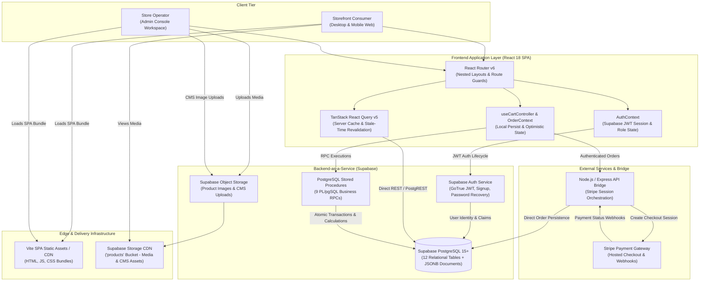

# Luxury Fragrance E-Commerce Platform  Architecture Showcase

A documentation-first architectural case study of a bespoke Haute Parfumerie and digital commerce platform engineered for the prestige fragrance market, featuring luxury catalog exploration, variant-level inventory management, and an in-house headless CMS.

---

## Executive Overview

The **Luxury Fragrance E-Commerce Platform** reconciles the sensory opulence of prestige perfumery with modern web engineering. The platform features an olfactory note architecture (Top, Heart, and Base fragrance pyramids), variant-level bottle inventory control, an in-house custom headless CMS, gamified customer loyalty mechanics, and dual payment rails (Stripe Hosted Checkout & Regional Cash on Delivery).

The application couples a high-performance **React 18 SPA** with **Supabase (PostgreSQL 15+, GoTrue Auth, Storage CDN, PostgREST)** and a targeted **Node.js/Express API bridge** for PCI-compliant Stripe session creation. Sensitive business invariants—including atomic cart totals, promo coupon redemption, loyalty point calculations, and analytics aggregations—are enforced server-side via **9 PostgreSQL stored procedures (RPCs)**.

---

## System Context Architecture

---

## Engineering Highlights

- **Olfactory Data Modeling:** Domain-tailored JSONB schemas modeling three-dimensional fragrance pyramids (Top, Heart, and Base notes) alongside multi-size bottle variants (`sizes: [{size, price, stock}]`) with live stock verification.
- **Zero-Dependency Headless CMS:** In-house dynamic CMS storing polymorphic page schemas in PostgreSQL JSONB (`page_content`), enabling store operators to edit hero banners, curated Fragrance Worlds, marketing tickers, and legal policies with zero application redeployments.
- **Server-Side RPC Pricing & Security:** 9 custom PL/pgSQL stored procedures (`calculate_cart_total`, `apply_coupon`, `apply_points`, `dashboard_stats`, etc.) executing server-side to guarantee zero price-tampering vulnerabilities.
- **Dual Layout & Theme Isolation:** Dynamic `.admin-theme` class injection on `document.body` at runtime, transforming the storefront into a high-contrast dark operations console with Recharts business intelligence without layout bleed.
- **Multi-Rail Checkout:** Dual payment rails supporting Stripe Hosted Checkout (credit/debit cards) and localized UAE Cash on Delivery (COD) across all seven Emirates with UAE phone formatting verification (`^(\+971|0)?[0-9]{9,10}$`).
- **Stratified Client-Side Caching:** TanStack React Query v5 caching with stratified TTLs (1 hour for CMS documents, 5 minutes for product catalog, instant invalidation for cart mutations).

---

## Documentation Map

| Topic | Guide | Description |
|---|---|---|
| **Representative Code Examples** | [Code Examples](docs/code-examples.md) | Production snippets: Supabase client, Axios JWT interceptor, CMS hydration, and JSONB queries. |
| **In-House Headless JSONB CMS** | [Headless JSONB CMS](docs/headless-jsonb-cms.md) | Deep dive into JSONB document schemas, zero-deployment content authoring, and fallback resilience. |
| **Architectural Decision Records** | [ADR Index](docs/decisions/README.md) | Context, decisions, trade-offs, and evaluated alternatives for core platform architecture. |
| **Diagram Source Files** | [Diagram Sources](diagrams/README.md) | Reusable Mermaid definitions for system context, component tree, ERD, and CMS lifecycle. |

---

## Technology Map

| Layer | Technologies / Patterns | Purpose & Architecture |
|---|---|---|
| **Frontend Framework** | React 18.2, Vite 4.4.5 | ESM bundling, path aliasing (`@` to `src/`), Suspense and concurrent rendering. |
| **Styling & Design System** | Tailwind CSS 3.3, `tailwindcss-animate` | HSL CSS custom property tokens, luxury cream/gold aesthetic, glassmorphism (`.glass-card`). |
| **Component Primitives** | Radix UI Headless Primitives | Accessible UI dialogs, tabs, sliders, select dropdowns, and switch controls. |
| **Asynchronous State & Cache** | TanStack React Query v5.83 | Query deduplication, optimistic updates, and stratified background cache revalidation. |
| **Backend & Persistence** | Supabase (PostgreSQL 15+, PostgREST) | 12 normalized relational tables, JSONB document storage, Row-Level Security (RLS). |
| **Business Logic & RPCs** | 9 PostgreSQL PL/pgSQL Functions | Price calculation, coupon validation, loyalty point redemption, and analytics aggregation. |
| **Object Storage & CDN** | Supabase Storage (`products` bucket) | High-resolution fragrance bottle photography and CMS media uploads with public CDN delivery. |
| **Payment Gateway** | Stripe Checkout API & React Stripe.js | Hosted checkout session redirection, card authorization, and asynchronous webhook reconciliation. |
| **Operations Analytics** | Recharts 2.8 | Admin dashboard 6-month revenue trends and top SKU performance visualizations. |

---

## Contact & Credits

**M Nawaz Khan — Full Stack Developer & Software Architect**

- GitHub: [Nawaz393](https://github.com/Nawaz393)
- LinkedIn: [Muhammad Nawaz Khan](https://www.linkedin.com/in/nawaz393)

[Documentation Index](docs/README.md)
