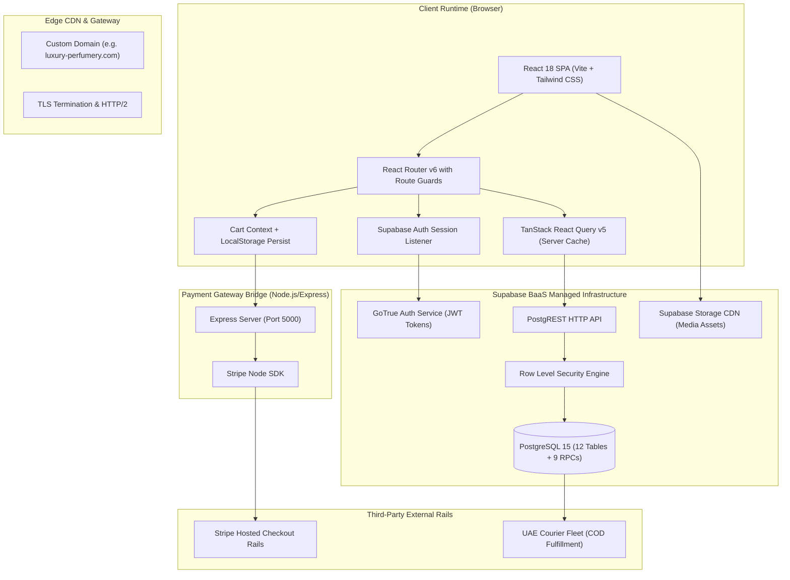

# System Architecture & Component Lifecycle

[← Main README](../README.md) · [← Documentation Index](README.md)

This document provides a comprehensive architectural breakdown of the **Luxury Fragrance E-Commerce Platform**, detailing the React 18 frontend runtime, TanStack Query hydration, Supabase BaaS data layer, Express API bridge, and caching strategies.

---

## 1. High-Level Component Topology

---

## 2. Request & Data Hydration Lifecycle

1. **Initial Mount**:
   - `index.html` loads bundled React chunks with dynamic font subsets (`Cinzel`, `Playfair Display`, `Montserrat`).
   - `supabaseClient.js` initializes with `anon_key` and connects to the GoTrue WebSocket listener for session state (`onAuthStateChange`).
2. **Server State Hydration**:
   - Storefront components query catalog and CMS content via **TanStack React Query v5**.
   - `staleTime` is configured hierarchically:
     - Fragrance Catalog (`products`, `categories`): 10 minutes.
     - Headless CMS blocks (`home_cms`, `about_cms`, `hero_slides`): 60 minutes.
     - User Cart & Wishlist: 0 seconds (always fresh).
3. **Route Guards**:
   - `RequireAuth`: Intercepts protected user routes (`/profile`, `/orders`).
   - `RequireAdmin`: Validates `app_metadata.role === 'admin'` before mounting `/admin/*`. Injects `.admin-theme` dynamic CSS variables into document root.
   - `WithStripe`: Dynamically loads Stripe.js only when initiating checkout to optimize storefront Lighthouse performance.

---

## 3. Data Integrity via Stored Procedures (RPCs)

Rather than trusting client-side price math, critical mutations execute through PostgreSQL stored procedures:
- `calculate_cart_total(p_items jsonb, p_coupon_code text)`: Iterates over variant items, verifies stock in real-time, asserts coupon expiration, and emits verifiable tax and grand total.
- `apply_coupon(p_code text, p_cart_total numeric)`: Enforces minimum spend rules and single-use per customer constraints.
- `record_review(p_product_id uuid, p_rating int, p_comment text)`: Recomputes product aggregate rating atomically.

Related: [Domain Map](domain-map.md) · [Code Examples](code-examples.md) · [Headless CMS](headless-jsonb-cms.md)
