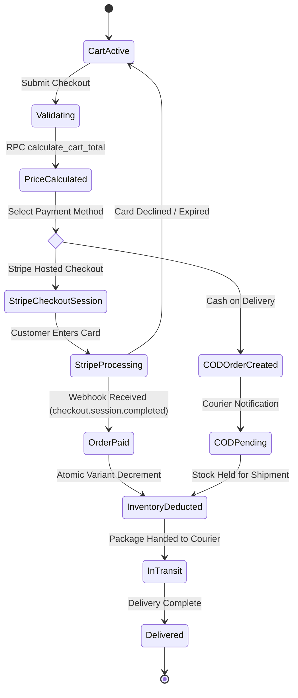

# Checkout Flow & Inventory Consistency

[← Main README](../README.md) · [← Documentation Index](README.md)

This document details the dual payment rails, checkout saga, inventory decrement rules, and reconciliation strategies in **LUXINPERFUMES.COM**.

---

## 1. Dual Payment Rails Architecture

LUXINPERFUMES.COM serves both international online shoppers and regional Middle Eastern clients by providing two distinct checkout rails:

| Rail | Target Audience | Settlement Flow | Fulfillment Trigger |
|---|---|---|---|
| **Stripe Hosted Checkout** | International & Card Buyers (AED/USD) | Immediate card authorization via Stripe API bridge | Webhook `checkout.session.completed` |
| **UAE Cash on Delivery (COD)** | Regional Dubai/UAE Customers | Order placed in `pending_cod` state | Courier dispatch confirmation |

---

## 2. Checkout Sequence & State Machine



---

## 3. Server-Side Atomic Stock Decrement

To prevent race conditions during flash fragrance sales (e.g., limited-edition Oud drops), inventory is checked and decremented at the database level:

```sql
CREATE OR REPLACE FUNCTION decrement_variant_stock(
  p_product_id uuid,
  p_size text,
  p_quantity int
)
RETURNS boolean AS $$
DECLARE
  v_current_stock int;
BEGIN
  -- Extract and lock the specific variant stock
  SELECT (sizes->p_size->>'stock')::int INTO v_current_stock
  FROM products
  WHERE id = p_product_id
  FOR UPDATE;

  IF v_current_stock < p_quantity THEN
    RAISE EXCEPTION 'Insufficient inventory for product % size %', p_product_id, p_size;
  END IF;

  -- Atomically update the JSONB document
  UPDATE products
  SET sizes = jsonb_set(
    sizes,
    ARRAY[p_size, 'stock'],
    to_jsonb(v_current_stock - p_quantity)
  )
  WHERE id = p_product_id;

  RETURN true;
END;
$$ LANGUAGE plpgsql SECURITY DEFINER;
```

---

## 4. Payment Failure & Reconciliation Scenarios

1. **Stripe Payment Abandonment**: User opens Stripe Checkout tab but closes browser. The Express server tracks session expiration (30-minute timeout); local cart items remain in `active` state and stock is not decremented.
2. **Duplicate Webhook Delivery**: Express webhook handler verifies `stripe_event_id` against the `processed_webhooks` table before mutating order state. Idempotency prevents duplicate order creation or stock over-decrement.
3. **COD Order Returns**: If a COD delivery fails at the doorstep, admin operator marks the order as `cancelled_returned`, triggering inventory replenishment via the admin console.

Related: [Architecture](architecture.md) · [Domain Map](domain-map.md) · [Code Examples](code-examples.md)
