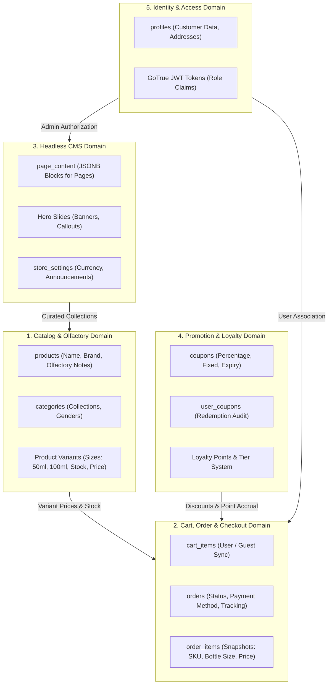

# Domain Map & Bounded Contexts

[← Main README](../README.md) · [← Documentation Index](README.md)

This document maps the domain boundaries, data models, entity relationships, and service responsibilities of the **Luxury Fragrance E-Commerce Platform**.

---

## 1. Domain Decomposition

---

## 2. Bounded Context Specifications

### 2.1 Catalog & Olfactory Domain
- **Entities**: `products`, `categories`, `brand_collections`.
- **Olfactory Architecture**:
  - Products contain JSONB olfactory pyramid definitions:
    - `top_notes`: Initial 15-minute scent impression (e.g. Bergamot, Saffron).
    - `heart_notes`: Core 4-hour fragrance body (e.g. Taif Rose, Jasmine).
    - `base_notes`: Deep 12+ hour sillage trail (e.g. Agarwood/Oud, Ambergris).
  - Variant arrays allow multiple bottle sizes (`30ml`, `50ml`, `100ml`) with discrete SKUs and real-time inventory counts.

### 2.2 Cart & Checkout Domain
- **Entities**: `cart_items`, `orders`, `order_items`.
- **Payment Rails**:
  - **Stripe Hosted Checkout**: PCI-compliant credit card processing with webhook fulfillment.
  - **UAE Cash on Delivery (COD)**: Regionally preferred payment rail with courier tracking integration.

### 2.3 Headless CMS Domain
- **Entities**: `page_content`, `store_settings`, `offers`.
- **Mechanism**: Eliminates expensive third-party CMS subscriptions by storing validated JSON documents in PostgreSQL JSONB fields. Admin console publishes changes with zero rebuild or deployment delays.

Related: [Architecture](architecture.md) · [Database Security](supabase-security-and-rls.md) · [Code Examples](code-examples.md)
